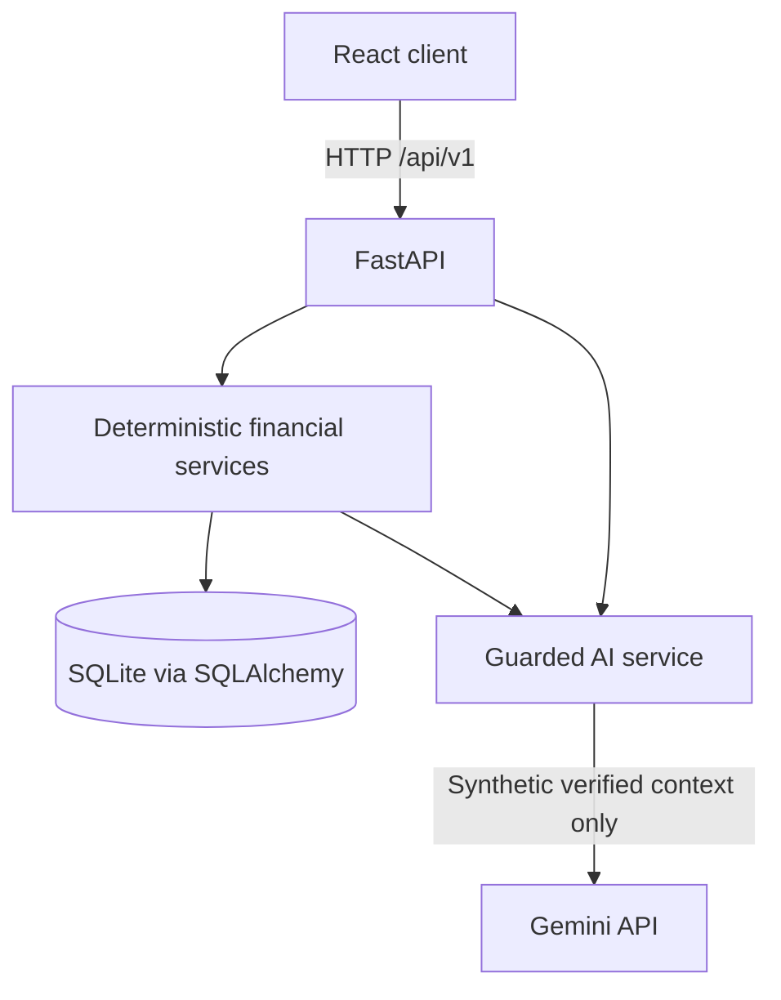

# Architecture

Monetra AI is a modular monolith: a React client communicates with FastAPI over HTTP and JSON. FastAPI owns input validation, all calculations and AI orchestration. SQLAlchemy writes demo data to local SQLite. The Gemini adapter will run on the server only.

## Key invariants

1. Currency amounts are stored as **integer paisa**.
2. Only deterministic Python functions produce authoritative balances and risks.
3. The purchase simulator is read-only.
4. Pending bills must not be double counted with recorded expenses.
5. Invalid/duplicate CSV imports must not affect financial totals.
6. The AI adapter fails closed; loss of Gemini does not disable financial views.
7. No real banking credentials, transfers, or personal data in demo scope.

## Planned backend boundaries

- `app/api/v1`: typed HTTP route handlers.
- `app/core`: runtime config and database session management.
- `app/models`: SQLAlchemy persistence models.
- `app/schemas`: Pydantic request/response contracts.
- `app/services`: imports, categorization, budgeting, forecasting, simulation, bills and Gemini.

See [API contract](api-contract.md) and [decision log](decisions.md).
